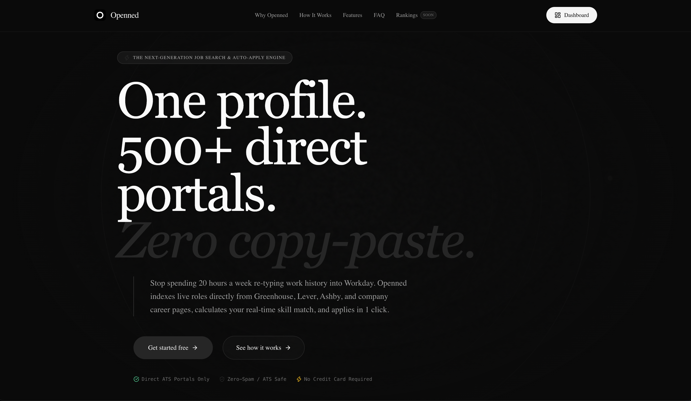
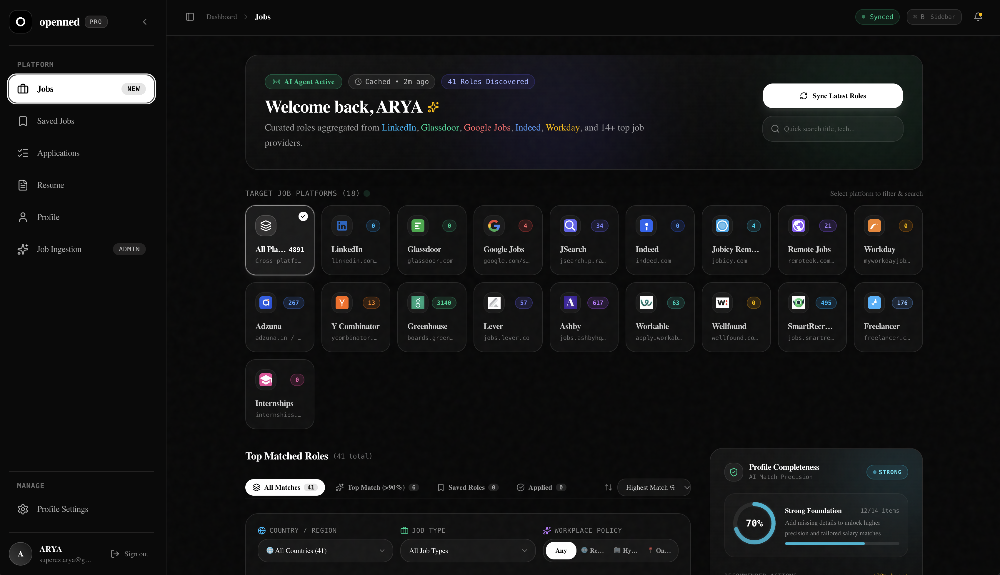
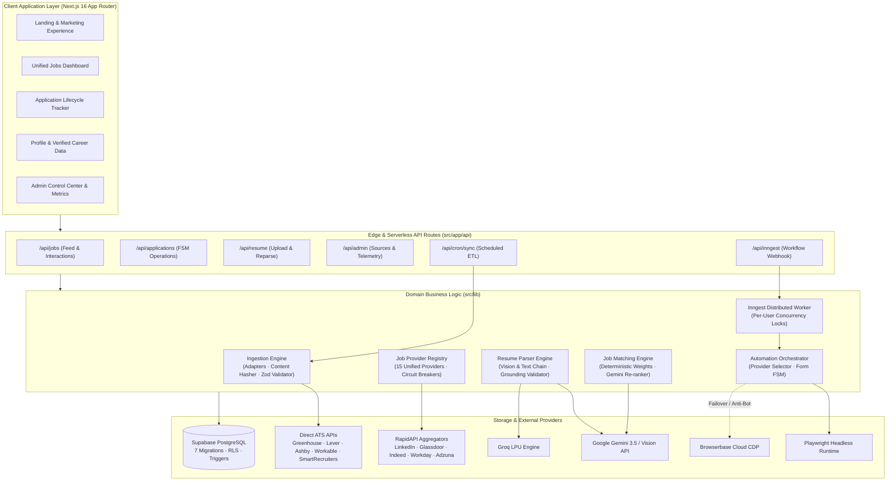
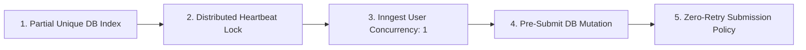
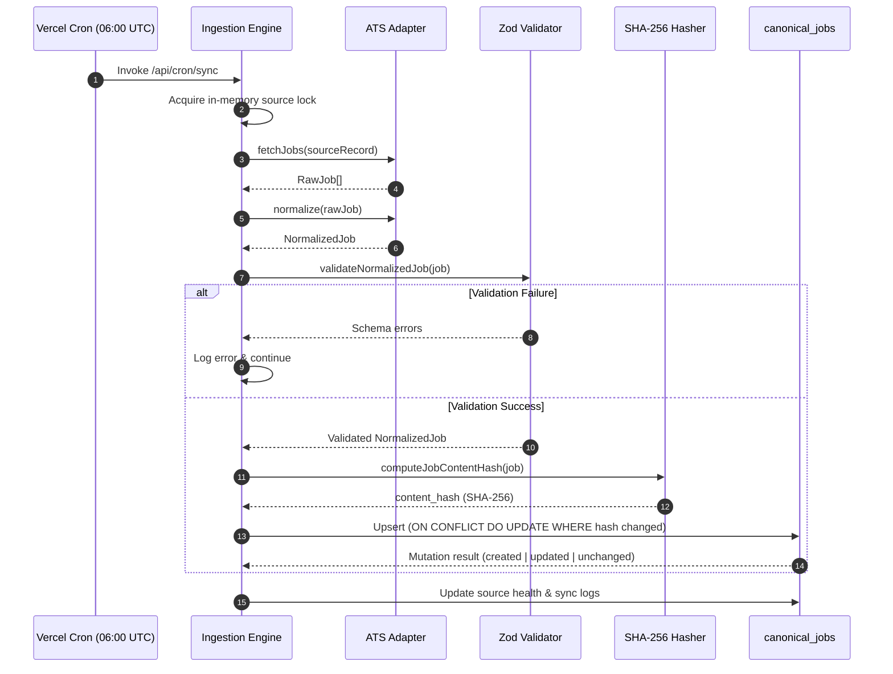
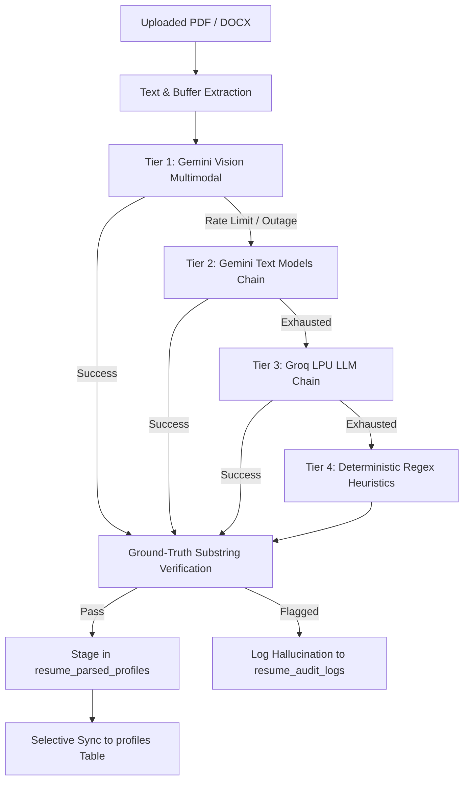
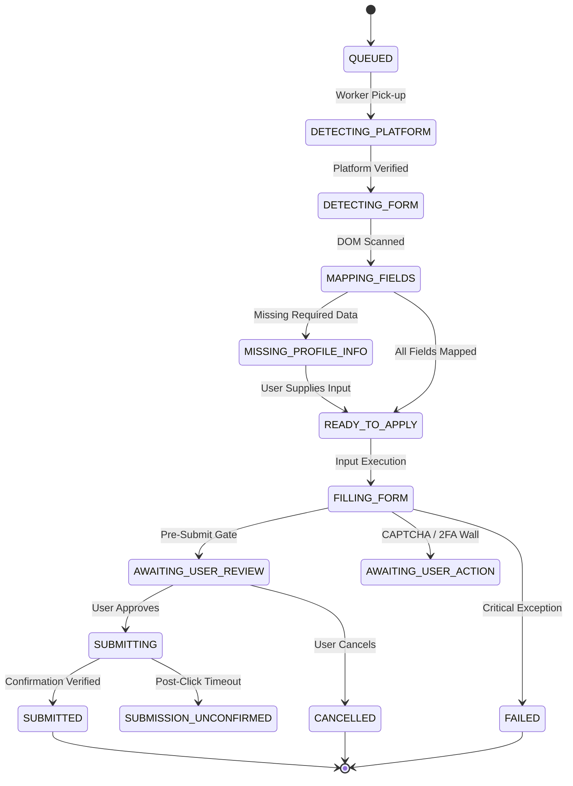
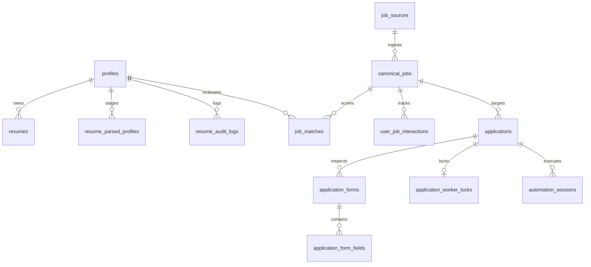
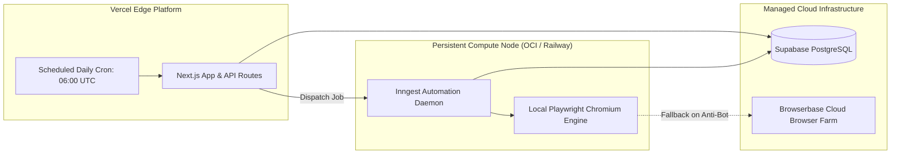

<p align="center">
  
</p>

<h1 align="center">Openned</h1>

<p align="center">
  <strong>Autonomous Multi-Platform Job Discovery & Application Automation Engine</strong><br/>
  Aggregating career portals across 18+ sources with explainable AI role-matching, zero-hallucination profile extraction, and resilient headless browser automation.
</p>

<p align="center">
  <a href="#system-architecture"></a>
  <a href="#system-architecture"></a>
  <a href="#system-architecture"></a>
  <a href="#database-design"></a>
  <a href="#ai-resume-parser"></a>
  <a href="#application-automation-engine"></a>
  <a href="#application-automation-engine"></a>
  <a href="#testing"></a>
</p>

---

## Executive Summary

**Openned** is an enterprise-grade full-stack platform engineered to eliminate redundant manual data entry in modern recruitment pipelines. It indexes live postings directly from leading Applicant Tracking Systems (Greenhouse, Lever, Ashby, Workable, SmartRecruiters, Wellfound) and major aggregators, computes multi-dimensional candidate-job alignment, and executes automated multi-step application submissions using resilient browser automation.

### Core System Capabilities

| Pillar | Engineering Architecture | Key Guarantees |
|---|---|---|
| **Multi-Source Ingestion** | Adapter-based ETL pipeline with parallel fan-out across 7 ATS APIs and 15 live search providers | SHA-256 content deduplication, idempotent upserts, circuit breaker failure isolation |
| **Ground-Truth Parsing** | Multi-model fallback chain (Gemini Vision → Gemini Text → Groq LLM → Regex) | Zero hallucination: substring text-grounding validation and immutable field-level audit logs |
| **Precision Matching** | Deterministic 10-dimension weighted scoring engine + LLM-assisted re-ranking | Hard eligibility filters, profile versioning, sub-millisecond cached match lookups |
| **Resilient Automation** | Distributed state-machine FSM orchestrating Playwright with automatic cloud failover | Double-submission immunity, distributed worker locking, mid-flight session handoff |

---

## Table of Contents

1. [Product Interface](#1-product-interface)
2. [System Architecture](#2-system-architecture)
3. [Core Engineering Highlights](#3-core-engineering-highlights)
4. [Technology Stack & Architectural Tradeoffs](#4-technology-stack--architectural-tradeoffs)
5. [Job Ingestion & ETL Pipeline](#5-job-ingestion--etl-pipeline)
6. [AI Resume Parser & Validation Engine](#6-ai-resume-parser--validation-engine)
7. [Tailored Job Matching Engine](#7-tailored-job-matching-engine)
8. [Browser Automation & Form-Filling FSM](#8-browser-automation--form-filling-fsm)
9. [Database Schema & Relational Design](#9-database-schema--relational-design)
10. [API Reference](#10-api-reference)
11. [Security, Governance & Fault Tolerance](#11-security-governance--fault-tolerance)
12. [Testing & Quality Assurance](#12-testing--quality-assurance)
13. [Quickstart & Environment Setup](#13-quickstart--environment-setup)
14. [Deployment Architecture](#14-deployment-architecture)
15. [Contributing & Development Guidelines](#15-contributing--development-guidelines)
16. [Roadmap & Implementation Status](#16-roadmap--implementation-status)

---

## 1. Product Interface

### Landing Page & Portal Aggregator

*Public landing interface highlighting direct integrations with ATS backends (Greenhouse, Lever, Ashby), core zero-copy value proposition, and data privacy safeguards.*

### Live Analytics & Job Matching Dashboard

*Authenticated candidate cockpit showing live discovery metrics across 18 target platforms, multi-facet filtering (remote, workplace policy, seniority), profile completeness telemetry, and match score distribution.*

---

## 2. System Architecture

Openned is built as an edge-ready Next.js 16 modular monorepo leveraging React Server Components (RSC) for optimized initial payload delivery, backed by Supabase PostgreSQL, Inngest durable workflows, and an decoupled browser provider runtime.



### Directory Layout

```
openned/
├── src/
│   ├── app/                      # App router page trees and serverless API handlers
│   │   ├── api/                  # Application, ingestion, resume, admin, cron handlers
│   │   └── dashboard/            # Authenticated workspace: jobs, applications, profile, admin
│   ├── components/               # Accessible UI components (Tailwind CSS 4, shadcn/ui)
│   ├── lib/                      # Core business logic, engine services, and integrations
│   │   ├── applications/         # Lifecycle FSM, field mapping, form detectors
│   │   ├── automation/           # Browser abstraction, Browserbase provider, Playwright
│   │   ├── ingestion/            # Source adapters, SHA-256 hasher, Zod validator
│   │   ├── inngest/              # Background workers, concurrency limits, distributed locking
│   │   ├── job-providers/        # Real-time search registry, circuit breakers, deduplication
│   │   ├── matching/             # Scoring engine, career profile builder, AI re-ranker
│   │   ├── resume/               # Vision/Text parser chain, ground-truth validator
│   │   └── supabase/             # Typed SSR database clients and middleware
│   └── scrapers/                 # Domain-specific crawlers (Y Combinator Startup Jobs)
├── supabase/migrations/          # 7 sequential DDL migrations with RLS and partial indexes
└── tests/                        # 45+ integration, unit, and end-to-end test suites
```

---

## 3. Core Engineering Highlights

### 1. SHA-256 Content-Addressable Job Fingerprinting
Job boards regularly modify metadata (view counts, scrape timestamps) without changes to the underlying posting. Upserting solely on `(source, source_job_id)` leads to write amplification. Openned generates a deterministic SHA-256 fingerprint over semantic content (`company:::title:::location:::description:::apply_url`), preventing unnecessary database writes:

```sql
-- Idempotent upsert executing only upon true content drift
INSERT INTO public.canonical_jobs (...)
VALUES (...)
ON CONFLICT (source, source_job_id)
DO UPDATE SET
    title = EXCLUDED.title,
    description = EXCLUDED.description,
    content_hash = EXCLUDED.content_hash,
    updated_at = now()
WHERE canonical_jobs.content_hash != EXCLUDED.content_hash;
```

### 2. Provider-Agnostic Browser Automation (`BrowserProvider`)
To decouple workflow automation from browser runtimes, form detection and input filling are built against an abstract `BrowserProvider` interface. Both local headless Chromium and cloud-based anti-bot runtimes implement identical primitives:

```typescript
export interface BrowserProvider {
  readonly providerType: AutomationProvider;
  createSession(options?: SessionOptions): Promise<BrowserSession>;
  openPage(session: BrowserSession, url: string): Promise<PageHandle>;
  click(page: PageHandle, target: TargetSelector): Promise<void>;
  fill(page: PageHandle, target: TargetSelector, value: string): Promise<void>;
  uploadFile(page: PageHandle, target: TargetSelector, filePath: string): Promise<void>;
  evaluate<T, R>(page: PageHandle, fn: (arg: T) => R, arg?: T): Promise<R>;
  closeSession(session: BrowserSession): Promise<void>;
}
```

When local headless execution encounters timeouts, CAPTCHAs, or anti-bot defenses, the `BrowserProviderSelector` serializes the current DOM state, terminates the local process, spins up a remote session via Browserbase over CDP, and resumes execution seamlessly.

### 3. Multi-Layer Duplicate Application Prevention
Submitting duplicate job applications creates negative candidate signal and wastes employer review resources. Openned enforces a 5-layer anti-duplication invariant:



1. **Database-Level Partial Unique Index:**
   ```sql
   CREATE UNIQUE INDEX idx_unique_active_application_per_user_job
     ON public.applications(user_id, job_id)
     WHERE status NOT IN ('FAILED', 'CANCELLED');
   ```
2. **Distributed Application Worker Locks:** Heartbeat-renewed lease in `application_worker_locks` ensures single-worker execution.
3. **Queue Concurrency Restriction:** Inngest enforces `concurrency: { limit: 1, key: "event.data.user_id" }`.
4. **Pre-Submit State Commit:** `submit_attempted = true` is persisted to PostgreSQL *before* invoking DOM submit triggers.
5. **Zero-Retry Idempotency Guard:** `applicationResumeFunction` sets `retries: 0`. Any post-click network disconnect yields `SUBMISSION_UNCONFIRMED` requiring manual user review rather than automatic retry.

### 4. Zero-Hallucination Ground-Truth Verification
LLMs are prone to synthesizing plausible qualifications absent from the candidate's resume. The `ResumeProfileValidator` intercepts AI outputs and validates that every extracted string exists as a normalized substring within the original source text:

```typescript
export function verifyTextGrounding(rawText: string, candidateValue: string | null): boolean {
  if (!rawText || !candidateValue) return false;
  const normalizedRaw = normalizeForSearch(rawText);
  const normalizedValue = normalizeForSearch(candidateValue);
  return normalizedValue.length > 0 && normalizedRaw.includes(normalizedValue);
}
```

Any field failing grounding verification is rejected, flagged as hallucinated, and stored in `resume_audit_logs` with extraction confidence metadata without corrupting the active profile.

---

## 4. Technology Stack & Architectural Tradeoffs

| Component | Selection | Architecture Justification |
|---|---|---|
| **Framework** | Next.js 16 (App Router) | Server components streamline data-intensive job dashboards; co-locates API endpoints, Edge cron jobs, and UI. |
| **Language** | TypeScript 5 (Strict) | Enforces interface contracts across ATS adapters, API payloads, and state machines. |
| **Data Layer** | Supabase (PostgreSQL 15) | Relational integrity for user data, native JSONB support for raw ATS payloads, and Row-Level Security (RLS). |
| **Background Processing** | Inngest | Eliminates Redis/Celery operational overhead; provides durable execution, step functions, and concurrency control. |
| **Browser Engine** | Playwright + Browserbase | Local Playwright delivers low-latency automation; Browserbase provides cloud failover with stealth proxies. |
| **AI Processing** | Google Gemini + Groq | Multimodal Gemini Vision processes scanned PDF resumes; Groq LPU provides rapid failover for text extraction. |
| **Data Validation** | Zod v4 | Runtime boundary validation of external API inputs prior to database persistence. |
| **Testing** | Vitest | Fast ESM unit and integration testing; includes custom mock HTTP employer servers. |

---

## 5. Job Ingestion & ETL Pipeline

The ingestion pipeline synchronizes postings from ATS platforms and job boards, normalizes unstructured attributes, and stores canonical records.



### Supported Integration Adapters

- **Greenhouse (`GreenhouseAdapter`):** Consumes public board JSON feeds with paginated job detail retrieval.
- **Lever (`LeverAdapter`):** Consumes Lever Postings REST endpoints mapped by company identifiers.
- **Ashby (`AshbyAdapter`):** Interfaces with Ashby's GraphQL board APIs for structured location/team metadata.
- **Workable (`WorkableAdapter`):** Ingests structured postings via Workable accounts API.
- **Wellfound & SmartRecruiters:** Native adapters parsing startup ecosystem listings and corporate ATS records.
- **Fallback HTML/JSON-LD (`FallbackParser`):** Extracts schema.org `JobPosting` microdata from custom career pages.
- **Y Combinator Scraper (`YCombinatorScraper`):** Crawls and extracts company/role metadata from Work at a Startup.

---

## 6. AI Resume Parser & Validation Engine

The resume parsing system uses a multi-tier fallback architecture to extract structured candidate profiles without relying on single-provider availability.



### Extraction Schema
The parser yields structured records adhering to `StrictResumeExtraction`:
- **Personal Information:** Name, email, phone, location (workplace address excluded).
- **Verified Experience:** Role, employer, verified start/end dates, verified duration in months.
- **Categorized Skills:** Programming languages, frameworks, databases, developer tools, cloud infrastructure.
- **Education & Projects:** Institution, degree, graduation timeframe, project portfolio tech stack.

---

## 7. Tailored Job Matching Engine

Openned matches candidates using a deterministic, multi-dimensional scoring algorithm followed by optional LLM-assisted re-ranking.

### Scoring Dimensions & Weights

$$\text{Match Score} = \sum (W_i \times S_i) + \text{Bonuses} \quad [\text{Range: } 0 - 99]$$

| Dimension | Weight | Evaluation Logic |
|---|---|---|
| **Required Skills** | **50%** | Exact and taxonomic overlap between candidate skills and core requirements. |
| **Role Alignment** | **20%** | Semantic title similarity and role family classification (frontend, backend, fullstack). |
| **Preferred Skills** | **15%** | Secondary overlap with optional/nice-to-have technologies. |
| **Experience Fit** | **10%** | Candidate verified months vs. job minimum experience requirement. |
| **Education Fit** | **5%** | Degree level matching (Bachelor's, Master's, Ph.D.). |
| **Project Bonus** | +5 pts | Assigned when candidate projects leverage $\ge 2$ required technologies. |
| **Freshness Bonus** | +3 pts | Tiered decay: +3 (<24h), +2 (<72h), +1 (<7d). |

### Hard Eligibility Filters
Before calculating composite scores, candidates are evaluated against strict gating rules:
- **User Preference Filter:** Excludes postings previously marked as `hidden` or `not_relevant`.
- **Role Family Guard:** Prevents engineering candidates from being matched with non-technical roles.
- **Seniority Safeguard:** Early-career candidates (<24 months verified experience) are filtered out from Lead, Staff, Principal, and 36+ month roles.
- **Education Gating:** Filters roles mandating advanced degrees (e.g., Ph.D.) if not held by the candidate.

---

## 8. Browser Automation & Form-Filling FSM

The automation engine executes applications through a 15-state Finite State Machine (FSM):



### Form Field Resolution Pipeline
1. **Platform Detection:** Inspects hostname, URL patterns, meta tags, and DOM signatures to classify the host ATS.
2. **Schema Introspection:** Traverses the active DOM/iframes to catalog labels, IDs, input types, and required constraints.
3. **Semantic Mapping:** Maps fields to candidate attributes via direct key matching, semantic dictionary lookup, or fallback AI inference.
4. **Resilient Interaction:** Executes keystroke-level text entry, select/radio choices, and file upload attachments via native file choosers.

---

## 9. Database Schema & Relational Design

Openned uses 7 sequential database migrations in Supabase PostgreSQL with strict Row-Level Security (RLS) policies.



### Primary Relational Tables

- **`canonical_jobs`:** Core repository of global job postings. Indexed on `content_hash`, `source`, `posted_at DESC`, and `active`.
- **`job_sources`:** ATS source configuration, sync health metrics, and failure counters driving the circuit breaker.
- **`applications`:** State record of every user application attempt. Indexed with partial unique constraints preventing duplicate submissions.
- **`job_matches`:** Pre-calculated match scores with `profile_version` invalidation tracking.
- **`resume_parsed_profiles` & `resume_audit_logs`:** Staging tables and immutable audit logs storing source grounding evidence for AI extractions.
- **`application_worker_locks`:** Distributed lock leases ensuring mutually exclusive background task execution.

---

## 10. API Reference

All API routes require authenticated Supabase SSR session context; unauthenticated requests return `401 Unauthorized`.

| Method | Endpoint | Description |
|---|---|---|
| `GET` | `/api/jobs` | Retrieve personalized, paginated job feed with match scores. |
| `PATCH` | `/api/jobs` | Update job interaction flags (`saved`, `applied`, `hidden`, `not_relevant`). |
| `GET` | `/api/jobs/search` | Execute real-time multi-provider search across 15 platforms. |
| `POST` | `/api/applications` | Initialize a new application record (idempotent). |
| `POST` | `/api/applications/[id]/start` | Enqueue background browser automation via Inngest. |
| `POST` | `/api/applications/[id]/review` | Submit user pre-submission approval or rejection. |
| `POST` | `/api/applications/[id]/cancel` | Terminate active application lifecycle. |
| `GET` | `/api/applications/[id]/session` | Inspect live browser automation debug and replay URLs. |
| `POST` | `/api/resume/upload` | Upload resume file (PDF/DOCX); triggers extraction and grounding pipeline. |
| `POST` | `/api/resume/reparse` | Re-run parser engine on stored resume using updated models. |
| `GET` | `/api/admin/job-sources` | List configured ATS endpoints, sync health, and error states. |
| `POST` | `/api/admin/job-sources/sync` | Manually trigger sync execution for targeted sources. |
| `GET` | `/api/admin/automation-metrics` | Telemetry on automation success, local vs. cloud fallback, and failure codes. |
| `GET` | `/api/cron/sync` | Edge-triggered scheduled daily job synchronization. |
| `POST` | `/api/inngest` | Inngest workflow webhook handler. |

---

## 11. Security, Governance & Fault Tolerance

### XSS & Injection Sanitization
Job postings contain untrusted third-party HTML. `sanitizeHtml()` processes all ingested content prior to storage:
- Strips executable tags: `<script>`, `<iframe>`, `<object>`, `<embed>`, `<svg>`, `<meta>`.
- Removes all inline event listeners (`onload`, `onerror`, `onclick`).
- Disallows non-standard URI schemes, permitting only `http:`, `https:`, and `mailto:`.

### Circuit Breaker Pattern
External job providers are monitored by an in-memory circuit breaker:
- Transitions to **OPEN** after 3 consecutive failures; halts outbound calls for a 30s cooldown (60s on HTTP 429).
- Enters **HALF-OPEN** to test provider recovery with a single probe request.
- Automatically resets to **CLOSED** on verified success.

### Row-Level Security (RLS)
All candidate data tables enforce strict PostgreSQL RLS policies ensuring users can only read and mutate their own records:
```sql
CREATE POLICY "Users can only access own applications"
  ON public.applications
  FOR ALL
  USING (user_id = auth.uid()::text);
```

---

## 12. Testing & Quality Assurance

Openned maintains a comprehensive test suite executed via **Vitest**, covering unit logic, integration boundaries, and browser interactions.

```
tests/
├── Adapters (7 files)          # Greenhouse, Lever, Ashby, Workable, Wellfound, SmartRecruiters, Adzuna
├── Core Engine (7 files)       # Hasher, normalizer, Zod schema validator, circuit breaker, retry backoff
├── Security (1 file)           # XSS neutralization, URI scheme attacks, HTML sanitization
├── Data Quality (3 files)      # Date parsing, data hygiene audits, listing consistency
├── Job Search (3 files)        # Provider registry fan-out, search deduplication, source discovery
├── Matching Engine (1 file)    # Deterministic scoring, seniority filters, company diversity caps
├── Resume Engine (2 files)     # Multi-model fallback chain, ground-truth anti-hallucination verification
├── Applications (9 files)      # Platform detection, field mapping, FSM transitions, mock employer server
└── Automation (2 files)        # Browserbase CDP connection, local-to-cloud failover flow
```

```bash
# Execute entire test suite
pnpm test

# Run critical security and zero-hallucination suites
pnpm vitest run tests/security-sanitization.test.ts
pnpm vitest run tests/resume/zero-hallucination.test.ts
pnpm vitest run tests/applications/full-automation-flow.test.ts
```

---

## 13. Quickstart & Environment Setup

### Prerequisites
- **Node.js:** `v20.x` or higher
- **Package Manager:** `pnpm` (v9+)
- **PostgreSQL Database:** Supabase project instance
- **AI Credentials:** Google Gemini API Key

### Environment Configuration
Copy `.env.example` to `.env.local` and configure credentials:

```bash
# Core Supabase Configuration
NEXT_PUBLIC_SUPABASE_URL=https://your-project.supabase.co
NEXT_PUBLIC_SUPABASE_ANON_KEY=your-anon-key
SUPABASE_SERVICE_ROLE_KEY=your-service-role-key

# AI Model Configuration
GEMINI_API_KEY=your-gemini-key
GEMINI_PRIMARY_MODEL=gemini-3.5-flash-lite
GEMINI_FALLBACK_MODELS=gemini-3.5-flash,gemini-flash-latest,gemini-3.1-flash-lite

# Fallback LLM (Optional)
GROQ_API_KEY=your-groq-key
GROQ_PRIMARY_MODEL=openai/gpt-oss-120b

# Real-Time Job Search Providers (Optional)
RAPIDAPI_KEY=your-rapidapi-key
ADZUNA_APP_ID=your-adzuna-id
ADZUNA_APP_KEY=your-adzuna-key
ADZUNA_COUNTRY=us

# Automation & Background Jobs (Optional)
INNGEST_EVENT_KEY=your-inngest-key
INNGEST_SIGNING_KEY=your-inngest-signing-key
BROWSERBASE_API_KEY=bb_live_your_key
BROWSERBASE_PROJECT_ID=your-project-id
```

### Database Initialization
Apply the sequential SQL migrations to your Supabase instance:

```bash
supabase db push
# Or run migrations 20260901 through 20260907 via the Supabase SQL editor
```

### Run Locally

```bash
# Install dependencies
pnpm install

# Start development server
pnpm dev

# In a separate terminal, start Inngest dev server for background workflows
pnpm inngest:dev

# Seed database with sample jobs
pnpm jobs:seed
```

Navigate to `http://localhost:3000`.

---

## 14. Deployment Architecture



- **Frontend & API:** Deploy directly to **Vercel** with full Next.js 16 App Router support.
- **Scheduled Sync:** Scheduled automatically via `vercel.json` invoking `/api/cron/sync` at `0 6 * * *`.
- **Automation Worker:** While standard APIs run serverless, long-running browser tasks requiring Chromium binaries run best on persistent instances (OCI Compute, Railway, Fly.io) via the Inngest handler.

---

## 15. Contributing & Development Guidelines

Contributions from developers, designers, and testers are welcome.

### Submitting Improvements
1. **Fork the Repository:** Create a feature branch (`git checkout -b feature/lever-v2-adapter`).
2. **Follow Architectural Boundaries:**
   - Place all ATS ingestion logic under `src/lib/ingestion/adapters/`.
   - Adhere to the `JobSourceAdapter` and `BrowserProvider` interface contracts.
   - Run type checks and linters: `pnpm lint && tsc --noEmit`.
3. **Verify via Tests:** Ensure all new adapters or features include corresponding Vitest test files under `tests/`.
4. **Submit a Pull Request:** Describe the problem solved, architectural changes made, and test validation evidence.

---

## 16. Roadmap & Implementation Status

| Feature / Subsystem | Status | Notes |
|---|---|---|
| **ATS Ingestion Pipeline** | Completed | 7 native adapters, fallback HTML/JSON-LD parser, and YC scraper |
| **Unified 15-Provider Search** | Completed | JSearch, Adzuna, LinkedIn, Glassdoor, Indeed, Workday, etc. with circuit breakers |
| **Multi-Model Resume Parser** | Completed | Gemini Vision/Text, Groq fallback, and ground-truth validation |
| **Tailored Role Match Engine** | Completed | 10-dimension weighted scoring, eligibility gating, and caching |
| **Playwright Form Automation** | Completed | 15-state FSM, platform detection, field mapping, pre-submit safety |
| **Cloud Browserbase Fallback** | Completed | Mid-flight session handoff, residential proxy routing |
| **Admin Observability Center** | Completed | Source sync status, error rates, and automation metrics |
| **Billing Integration** | In Progress | Interface scaffolded under `/dashboard/billing`; payment gateway pending |
| **In-Browser Resume Preview** | In Progress | Document upload and parsing active; canvas-based inline viewer in development |
| **Browser Extension** | Planned | Third-party job portal detection and one-click submission integration |

---

<p align="center">
  <sub>Engineered with Next.js 16 · React 19 · TypeScript · Supabase · Google Gemini · Playwright · Inngest</sub>
</p>
